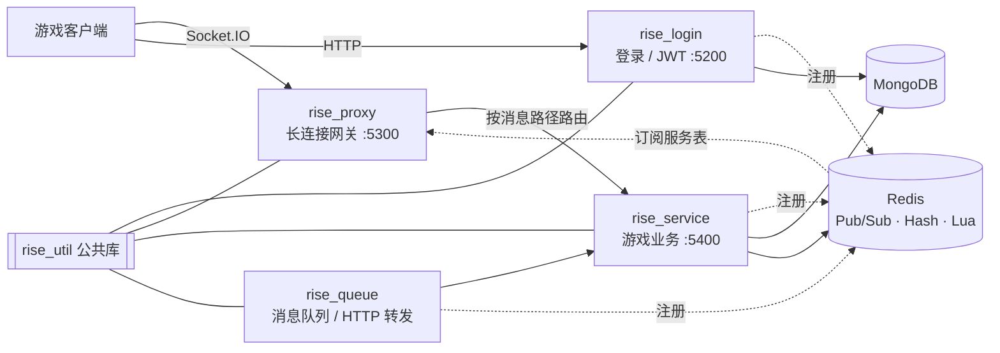

# Rise — TypeScript 分布式游戏服务端框架

> 用 TypeScript 从零实现的轻量级游戏服务端框架：网关、登录、业务、消息队列四类服务 + 一个公共工具库，服务之间通过 Redis Pub/Sub 自动注册发现，客户端经 Socket.IO 长连接接入。


[](LICENSE)

## 亮点

- **四类服务 + 公共库**：`rise_proxy`（长连接网关）、`rise_login`（登录鉴权）、`rise_service`（游戏业务）、`rise_queue`（消息队列 / HTTP 转发）与 `rise_util`（公共库），源码合计约 4000 行 TypeScript。
- **服务自动注册发现**：各服务启动后通过 Redis Pub/Sub 广播注册信息，网关订阅后维护在线服务表，无需手工配置下游地址（`*/src/network/registrAction.ts`、`rise_proxy/src/network/serviceRecord.ts`）。
- **长连接网关**：客户端只连 `rise_proxy`，网关校验 JWT 后按消息路径把请求路由到业务服务，并把结果推回对应玩家连接（`rise_proxy/src/network/proxyServer.ts`）。
- **回合制房间管理**：基于 Redis Hash 存储房间状态，出手顺序生成、成员批量更新 / 移除、提交操作等关键步骤用 Lua 脚本保证原子性，并带过期回收（`rise_service/src/util/roundRoomManager.ts`）。
- **策划配置工具链**：Excel ↔ JSON 双向转换，配置表直接驱动业务（`rise_service/src/util/excelToJsonConverter.ts`、`jsonToExcelMerger.ts`）。
- **公共库 `rise_util`**：Redis 连接与分布式锁、定时任务、日志、加解密、服务信封协议等，各服务以 npm 依赖方式复用。

## 架构



## 技术栈

| 领域 | 选型 |
| --- | --- |
| 语言 | TypeScript（ts-node 运行） |
| 通信 | Socket.IO、Express、http-proxy-middleware |
| 存储 | MongoDB（Mongoose）、Redis（ioredis，Pub/Sub、Hash、Lua） |
| 鉴权 | JWT（jsonwebtoken） |
| 其他 | node-schedule 定时任务、xlsx 配置表转换、Docker |

## 目录结构

```
├── rise_proxy/     # 长连接网关：连接管理、JWT 校验、消息路由、服务表
├── rise_login/     # 登录服务：注册 / 登录、签发 JWT
├── rise_service/   # 游戏业务：玩家、房间、战斗流程、配置表
├── rise_queue/     # 消息队列与 HTTP 转发
├── rise_util/      # 公共库：Redis、锁、定时任务、日志、加解密、协议
└── test/           # 浏览器端联调页面
```

每个服务的目录结构一致：`app.ts`（入口）→ `mainServer.ts`（加载配置、连接 Redis / Mongo、注册服务）→ `src/network`（网络层）→ `src/router` / `src/controller`（业务）。

## 快速开始

前置：Node.js ≥ 16、Redis、MongoDB。

```bash
# 每个服务分别执行（以 rise_login 为例）
cd rise_login
npm install
cp .env.example .env          # rise=<配置名> 选择 config/config.<配置名>.json；填写 JWT_SECRET
# 按本机环境修改 config/config.<配置名>.json 中的 Redis / MongoDB 地址
npm start                     # npx ts-node app.ts
```

建议启动顺序：`rise_login` → `rise_service` → `rise_queue` → `rise_proxy`。`login`、`proxy`、`service` 三处的 `JWT_SECRET` 必须一致。服务启动后，用浏览器打开 `test/client.html` 即可联调。

## License

[MIT](LICENSE) © 邓卜文
